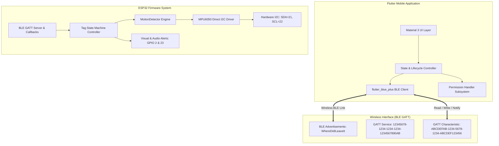
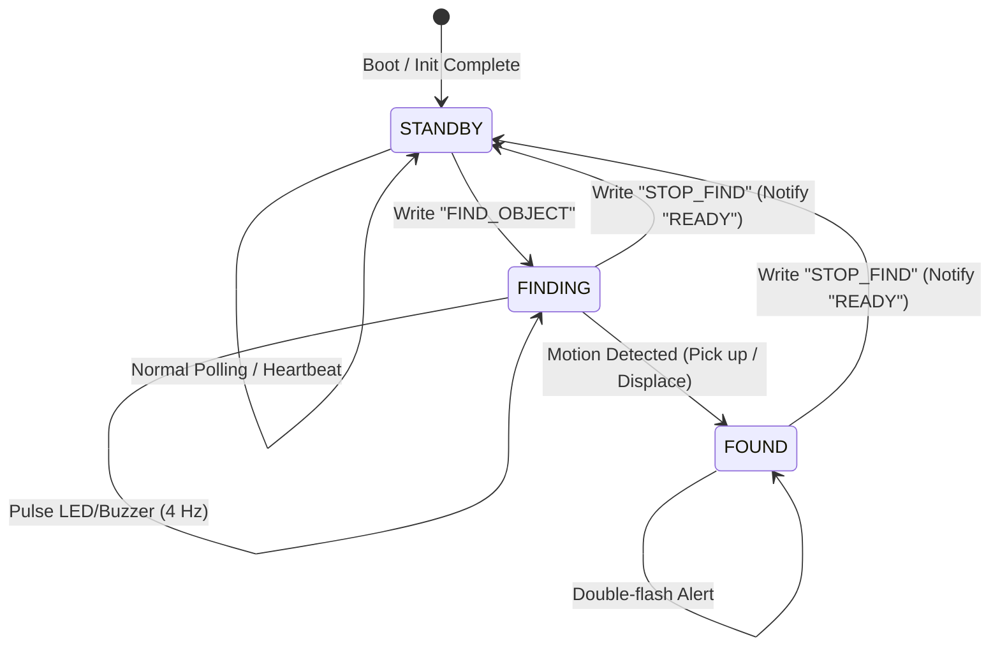
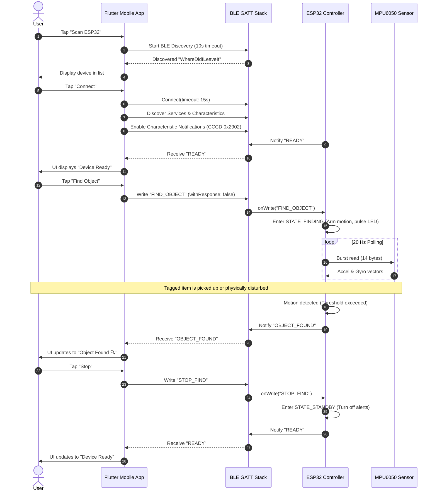

# TraceTag — System Architecture & Protocol Specification

## 1. Architectural Overview

TraceTag is an IoT-enabled smart object tracking and physical locator ecosystem. It bridges an ESP32-based hardware tag with an interactive Flutter mobile client over low-latency Bluetooth Low Energy (BLE 4.2 / 5.0).

---

## 2. Firmware Architecture Layers

### 2.1 Hardware Abstraction & Driver Layer (`MPU6050Handler`)
- **Direct I2C Register Control:** Built upon Arduino's native `<Wire.h>` library without external library dependencies (e.g. eliminating Adafruit BusIO / Unified Sensor dependency constraints).
- **Auto-Detection:** Probes primary address `0x68` and automatically falls back to `0x69` if AD0 is pulled high.
- **Power Management:** Automatically awakens sensor from default sleep state (`PWR_MGMT_1` = `0x00`).
- **Signal Filtering:** Configures Digital Low Pass Filter (DLPF) at register `0x1A` with ~44 Hz bandwidth to suppress high-frequency vibrational noise.
- **Burst Sampling:** Reads 14 sequential registers starting from `0x3B` (`ACCEL_XOUT_H`) in a single I2C transaction, converting 16-bit raw signed integers into SI units ($m/s^2$, $rad/s$, $^\circ C$).

### 2.2 Processing Layer (`MotionDetector`)
- **Acceleration Vector Magnitude:**
  $$\|\vec{a}\| = \sqrt{a_x^2 + a_y^2 + a_z^2}$$
- **Dynamic Baseline Compensation:** Continuously filters ambient gravitational baseline ($\sim 9.81\ m/s^2$) using an exponential smoothing filter when quiescent:
  $$B_{t} = 0.96 \cdot B_{t-1} + 0.04 \cdot \|\vec{a}\|$$
- **Angular Velocity Vector Magnitude:**
  $$\|\vec{\omega}\| = \sqrt{\omega_x^2 + \omega_y^2 + \omega_z^2}$$
- **Dual-Threshold Detection & Debounce:** Motion is declared true when deviation $|\|\vec{a}\| - B_t| > 2.0\ m/s^2$ OR $\|\vec{\omega}\| > 0.75\ rad/s$ for at least 2 consecutive polling cycles (`TRIGGER_CONFIRM_COUNT = 2`).

### 2.3 Communication Layer (BLE GATT Server)
- **Advertised Name:** `WhereDidILeaveIt`
- **Primary Service UUID:** `12345678-1234-1234-1234-1234567890AB`
- **Primary Characteristic UUID:** `ABCDEFAB-1234-5678-1234-ABCDEF123456`
- **Characteristic Permissions:** `READ`, `WRITE`, `NOTIFY`
- **Descriptor:** `BLE2902` Client Characteristic Configuration Descriptor (CCCD) enabled to support asynchronous notifications to Flutter.

---

## 3. Finite State Machine (FSM)

| State | Indicators | Sensor State | BLE Status |
| :--- | :--- | :--- | :--- |
| **STANDBY** | LED Off, Buzzer Off | Passive baseline tracking | Connected or Advertising |
| **FINDING** | LED & Buzzer pulsing at 4 Hz | Detection Armed | Notifies `READY` on entry |
| **FOUND** | Double-flash LED alert pattern | Motion confirmed | Notifies `OBJECT_FOUND` immediately |

---

## 4. End-to-End Sequence Diagram

---

## 5. Flutter Application Architecture

- **Entry Point:** `lib/main.dart`
- **SDK Compatibility:** Dart `>=3.0.0 <4.0.0`
- **Core Dependencies:**
  - `flutter_blue_plus: ^1.35.5` — BLE client abstraction
  - `permission_handler: ^11.4.0` — Runtime Bluetooth and Location permissions
  - `cupertino_icons: ^1.0.8` — Cross-platform iconography
- **Asset Configuration:**
  - Declared: `assets/logo.png`
  - Canonical location: `<project_root>/assets/logo.png`
- **Error Handling:** Graceful retry on failed connections, proactive stream cancellation during dispose, and UI state resilience against asynchronous unmounted callbacks.
